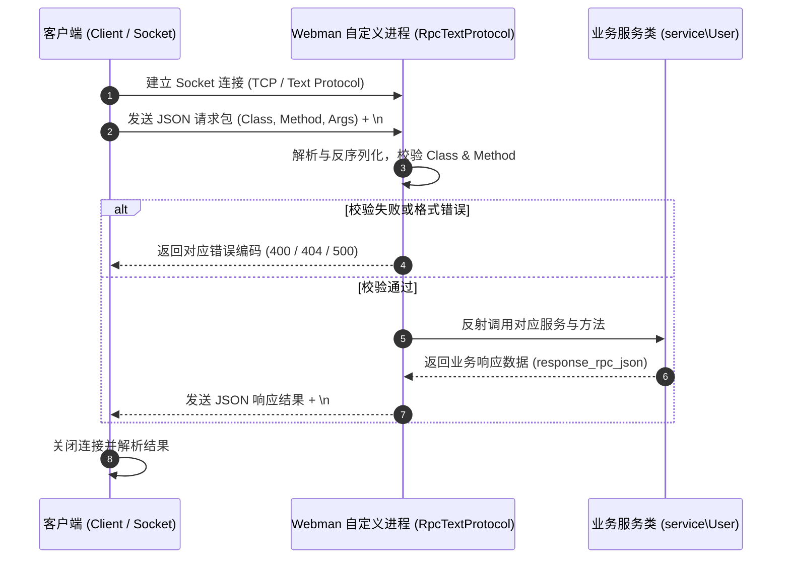

# Webman RPC Plugin

[](https://packagist.org/packages/tinywan/rpc)
[](https://packagist.org/packages/tinywan/rpc)
[](https://packagist.org/packages/tinywan/rpc)
[](https://packagist.org/packages/tinywan/rpc)
[](https://packagist.org/packages/tinywan/rpc)

基于 [Webman](https://www.workerman.net/doc/webman/) 自定义进程开发的高性能轻量级 RPC 插件，采用 Text 文本协议与 JSON-RPC 规范，提供开箱即用的跨进程 / 跨服务器远程过程调用支持。

---

## 🌟 特性概览

- ⚡ **高性能异步驱动**：基于 Workerman 自定义进程与 Text 文本协议，低开销、低延迟。
- 📦 **轻量无侵入**：服务端标准 PHP 类即服务，无复杂契约或代码生成。
- 🛡️ **健壮异常处理**：内置异常捕获与日志监控集成（支持钉钉等事件告警）。
- 🔌 **原生客户端**：提供 `Tinywan\Rpc\Client` 封装，支持灵活超时与流式通信。
- 🧪 **工程化质量保障**：集成 **Mago** 现代代码格式化 / 静态分析与 **Pest** 自动化测试套件。

---

## 🏗️ 架构与调用时序



---

## 📦 安装

在 Webman 项目根目录下执行：

```bash
composer require tinywan/rpc
```

---

## ⚙️ 配置说明

安装后插件配置文件位于 `config/plugin/tinywan/rpc/`：

- **`process.php`**：进程配置，默认监听 `text://0.0.0.0:9512`
- **`app.php`**：RPC 核心参数配置

```php
return [
    'enable' => true,
    'server' => [
        'namespace' => 'service\\',                  // 默认服务类命名空间
        'listen_text_address' => 'text://0.0.0.0:9512', // 服务监听地址
    ],
    'connect_timeout' => 5,                          // 客户端连接超时（秒）
    'request_timeout' => 5,                          // 客户端请求超时（秒）
];
```

---

## 🚀 快速上手

### 1. 服务端定义服务

在 Webman 项目根目录下新建 `service/User.php`（目录不存在可自行创建）：

```php
namespace service;

class User
{
    /**
     * 获取用户信息
     *
     * @param array $args
     * @return string
     */
    public function get(array $args): string
    {
        return response_rpc_json(0, '获取成功', [
            'uid'      => $args['uid'] ?? 0,
            'username' => 'Tinywan',
            'time'     => date('Y-m-d H:i:s'),
        ]);
    }
}
```

> [!TIP]
> 辅助函数 `response_rpc_json(int $code = 0, string $msg = 'success', array $data = [])` 可快速打包符合规范的 JSON 字符串。

---

### 2. 客户端调用

#### 方式一：使用内置 `Client` 类（推荐）

```php
use Tinywan\Rpc\Client;

$client = new Client('tcp://127.0.0.1:9512');

$response = $client->request([
    'class'   => 'User',
    'method'  => 'get',
    'args'    => [
        ['uid' => 2026]
    ],
    'timeout' => 5, // 可选超时时间（秒）
]);

var_dump($response);
```

#### 方式二：原生 Socket 调用

```php
$resource = stream_socket_client('tcp://127.0.0.1:9512', $errorCode, $errorMessage, 5);
if (false === $resource) {
    throw new \RuntimeException('RPC connect failed: ' . $errorMessage);
}

$request = [
    'class'  => 'User',
    'method' => 'get',
    'args'   => [
        ['uid' => 2026]
    ]
];

// Text 协议必须以换行符 \n 结尾
fwrite($resource, json_encode($request) . "\n");

// 读取响应结果
$result = fgets($resource, 10240000);
fclose($resource);

$response = json_decode(trim($result), true);
var_dump($response);
```

---

## 📋 协议与响应规范

### 1. 请求数据包规范

| 字段 | 类型 | 必填 | 说明 |
| :--- | :--- | :--- | :--- |
| `class` | `string` | 是 | 服务类名（相对配置的命名空间） |
| `method` | `string` | 是 | 服务方法名 |
| `args` | `array` | 否 | 方法入参列表 |
| `timeout` | `int` | 否 | 单次请求超时时间（秒） |

### 2. 响应数据包规范

- **正常响应格式**：
  ```json
  {
      "code": 0,
      "msg": "获取成功",
      "data": {
          "uid": 2026,
          "username": "Tinywan",
          "time": "2026-10-19 10:00:00"
      }
  }
  ```

- **异常响应格式**：
  ```json
  {
      "code": 404,
      "msg": "User Class is not exist!",
      "data": []
  }
  ```

### 3. 常见状态码

| 状态码 | 常量 | 描述 |
| :--- | :--- | :--- |
| `0` | `JsonParser::OK` | 业务请求成功 |
| `400` | `JsonParser::JSON_FORMAT_ERROR` | 请求数据不是合法的 JSON 格式 |
| `404` | `JsonParser::INVALID_CLASS_ERROR` | 目标类或方法不存在 |
| `500` | `JsonParser::SERVER_ERROR` | 服务端执行异常 |

---

## 🛠️ 代码质量与测试

本项目采用 **Mago**（代码检查与格式化）以及 **Pest**（单元与功能测试）：

```bash
# 格式化检查
composer format:check

# 自动格式化
composer format

# 代码语法与静态分析
composer lint
composer analyse

# 执行单元测试
composer test

# 执行全部检查流程
composer check
```

### Docker 容器测试（PHP 7.4）

```bash
# 在本地 dnmp-php74 容器中执行完整测试
docker exec -w /var/www/webman/webman-rpc dnmp-php74 composer test
```

---

## 📄 开源许可

本项目遵循 [MIT License](LICENSE) 开源协议。